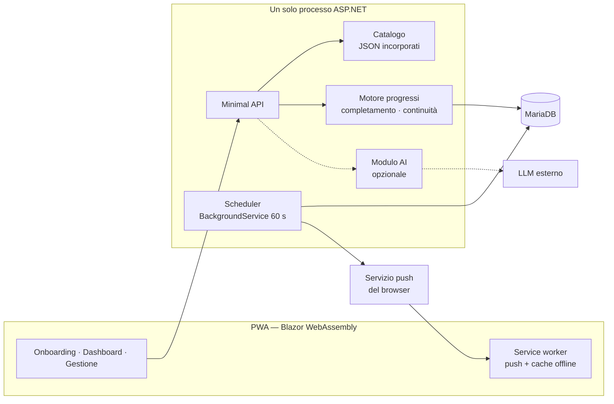
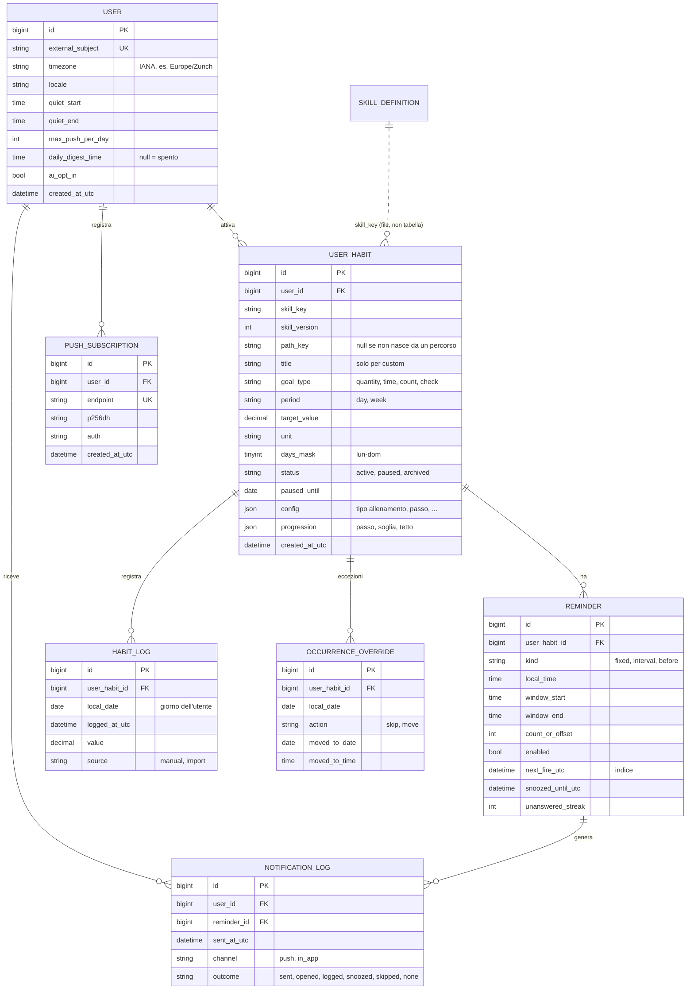
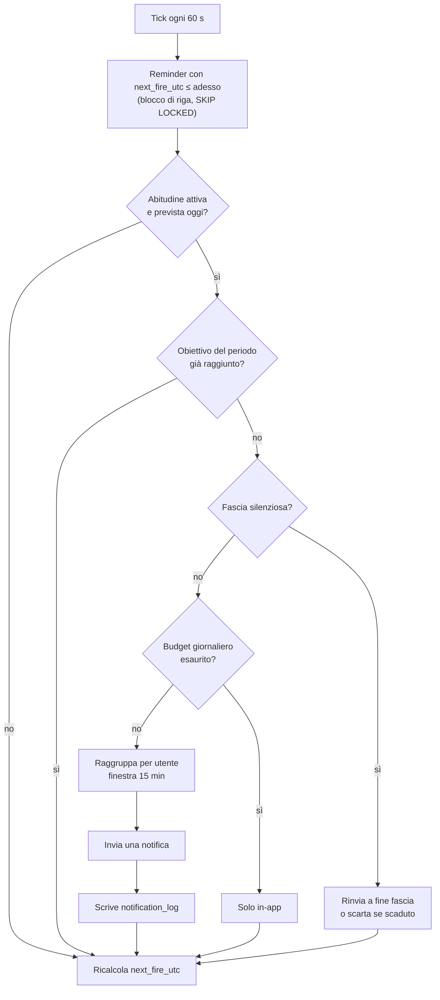

# Good Habits — Analisi architetturale e funzionale

Versione 0.1 · 13.11.2026 · nessun codice scritto

> **Superato in parte.** Dopo la revisione delle decisioni, Good Habits è una skill per assistenti AI e non
> un'applicazione. Architettura, modello dati, scheduler, API, MVP e roadmap di questo documento non valgono più:
> vedi [decisioni.md](decisioni.md). Restano validi i concetti (capitoli 3.1–3.3, 3.5, 3.6, 7.4, limiti del cap. 8).

Indice: [1 Executive summary](#1-executive-summary-e-fattibilità) ·
[2 Esistente](#2-analisi-dellarchitettura-esistente) ·
[3 Proposta concettuale](#3-proposta-concettuale) ·
[4 Catalogo](#4-catalogo-iniziale-delle-skill) ·
[5 Modello dati](#5-modello-dati) ·
[6 Scheduler](#6-architettura-dello-scheduler) ·
[7 UX](#7-user-journey-e-proposta-uxui) ·
[8 AI](#8-opportunità-ai-vantaggi-e-limiti) ·
[9 MVP](#9-definizione-dellmvp) ·
[10 Roadmap](#10-roadmap) ·
[11 Alternative](#11-alternative-architetturali) ·
[12 Raccomandazione e decisioni](#12-raccomandazione-finale-e-decisioni-da-approvare)

---

## 1. Executive summary e fattibilità

**Fattibile, con complessità media.** Il dominio (abitudini, obiettivi, registrazioni, progressi) è semplice e
ben noto. L'unica parte tecnicamente rischiosa sono le **notifiche push affidabili**, soprattutto su iOS.

Punti chiave:

1. **Non esiste un'applicazione ospite.** Il repository è nuovo: non ci sono autenticazione, utenti, persistenza,
   notifiche o scheduler da riutilizzare. Si riutilizzano invece stack e convenzioni già collaudate nel progetto
   personale OpenSana (capitolo 2).
2. **Le skill sono dati, non codice.** Ogni abitudine è una definizione dichiarativa (JSON versionato nel
   repository) interpretata da un piccolo numero di comportamenti fissi: 4 tipi di obiettivo, 4 regole di
   completamento, 3 tipi di reminder. Aggiungere un'abitudine = aggiungere un file, senza migrazioni né deploy
   di logica nuova.
3. **Un solo processo.** API + scheduler in-process (un `BackgroundService` che scatta ogni minuto e legge dal
   database i reminder scaduti). Niente microservizi, code o motori di job esterni.
4. **PWA come client.** Una sola base di codice, installabile su telefono e desktop, notifiche via Web Push.
   Limite noto: su iOS il push funziona solo con la PWA aggiunta alla schermata Home.
5. **AI facoltativa e periferica.** Tutto il nucleo è deterministico. Un LLM dà valore reale in tre punti soli:
   suggerimento iniziale da obiettivi espressi a parole, riepilogo settimanale ragionato, contenuti generati
   (meditazione guidata, micro-programmi).
6. **Motivazione senza colpa.** "Continuità" su finestra mobile al posto dello streak che si azzera; pause e salti
   pianificati non penalizzano; nessuna classifica.

MVP realistico: 7 abitudini, onboarding, dashboard, registrazione rapida, reminder push con snooze/skip e fasce
silenziose, continuità settimanale. Senza AI, senza email, senza integrazioni esterne.

---

## 2. Analisi dell'architettura esistente

### 2.1 Repository Good Habits

Vuoto al momento dell'analisi (solo questo documento). Tutte le voci richieste risultano quindi **assenti**:

| Elemento | Stato | Conseguenza |
|---|---|---|
| Stack tecnologico | da scegliere | decisione D2 |
| Autenticazione e utenti | assente | da introdurre, decisione D3 |
| Persistenza | assente | da introdurre, decisione D4 |
| Notifiche | assente | da introdurre (rischio principale) |
| Scheduler / background job | assente | da introdurre, in-process |

### 2.2 Riferimento riutilizzabile: OpenSana

Unico progetto personale affine esaminato (sola lettura). Non è l'applicazione ospite,
ma fornisce stack e schemi già funzionanti:

| Aspetto | OpenSana | Riuso per Good Habits |
|---|---|---|
| Client | Blazor WebAssembly standalone, .NET 10, CSS proprio | sì, più manifest e service worker (PWA) |
| API | ASP.NET minimal API | sì |
| Accesso dati | Dapper | sì |
| Database | MariaDB via `db/docker-compose.yml` + script `init` | sì (stessa struttura cartelle) |
| Localizzazione | `Microsoft.Extensions.Localization` (resx), it/de/fr/en | sì, si parte da it |
| Test | progetto xUnit unico in `tests/` | sì |
| Struttura | `src/`, `tests/`, `db/`, `docs/`, `tools/`, `.slnx` | sì |
| Utenti / login | **nessuno** (contributi anonimi con token nel browser) | niente da riusare |
| Notifiche, scheduler | **nessuno** | niente da riusare |

Conclusione: si riusano scelte e struttura, non componenti. Good Habits **non** va innestato in OpenSana:
dominio diverso, e OpenSana è anonimo per scelta mentre Good Habits richiede un account (alternativa F, cap. 11).

### 2.3 Skill utente e Claude Code Skills

Sono due cose diverse che condividono solo il nome:

- **Skill funzionale (utente)**: una voce del catalogo, cioè un file `catalog/<chiave>.json` letto
  dall'applicazione a runtime. È ciò che l'utente sceglie e configura.
- **Claude Code Skill (`SKILL.md`)**: istruzioni per l'assistente di sviluppo, lette solo in fase di sviluppo.
  Mai distribuite con l'app, mai visibili all'utente.

Una Claude Code Skill utile sarebbe una sola: `add-habit-skill` (come scrivere e validare una nuova voce di
catalogo: campi obbligatori, testi in tutte le lingue, default prudenti, test di validazione). **Rinviata** finché il
catalogo non supera una quindicina di voci: prima basta lo schema JSON e un test che valida tutti i file.

---

## 3. Proposta concettuale

### 3.1 Quattro concetti distinti

| Concetto | Cos'è | Dove vive | Esempio |
|---|---|---|---|
| **Obiettivo** | cosa l'utente vuole ottenere in un periodo | `user_habit` | 10 pagine al giorno |
| **Attività pianificata** | un'istanza attesa in una data | **calcolata** da obiettivo + calendario; salvate solo le eccezioni (`occurrence_override`) | lettura di martedì 17.11 |
| **Reminder** | regola che decide quando avvisare | `reminder` (+ `notification_log` per gli invii) | ogni giorno alle 21:00 |
| **Registrazione** | fatto avvenuto, inserito dall'utente | `habit_log` | 12 pagine lette alle 21:40 |

Le attività pianificate non si materializzano in tabella: per un'abitudine giornaliera l'istanza è deducibile da
(abitudine, data). Si salva una riga solo quando l'utente salta o sposta un'istanza. Meno dati, niente job di
generazione, niente righe orfane dopo una modifica della frequenza.

### 3.2 Skill = definizione dichiarativa

Una skill non contiene logica. Sceglie tra comportamenti già presenti nel motore:

**Tipi di obiettivo**

| Tipo | Significato | Esempi |
|---|---|---|
| `quantity` | somma di valori nel periodo ≥ target | acqua, pagine, minuti, passi |
| `time` | un orario dichiarato entro una soglia | a letto entro le 22:00 |
| `count` | N volte nel periodo | 3 allenamenti a settimana |
| `check` | fatto / non fatto | pianificare la giornata |

**Regole di completamento** (una per tipo): `sum_at_least`, `time_before`, `count_at_least`, `checked`.
Nessun linguaggio di espressioni: se un giorno servirà una regola nuova, si aggiunge un caso al motore.

**Tipi di reminder**: `fixed` (orario fisso), `interval` (distribuiti in una fascia, es. idratazione),
`before` (anticipo su un'attività con orario, es. 30 minuti prima dell'allenamento).

Esempio di definizione (illustrativo, non codice dell'applicazione):

```json
{
  "key": "hydration",
  "version": 1,
  "category": "nutrition",
  "goalType": "quantity",
  "period": "day",
  "unit": "ml",
  "defaults": { "target": 2000, "step": 250, "days": "daily" },
  "limits": { "targetMin": 500, "targetMax": 4000 },
  "reminder": { "kind": "interval", "windowStart": "08:00", "windowEnd": "21:00", "count": 6 },
  "quickLog": [250, 500],
  "progression": null,
  "texts": "resx:Skill.Hydration"
}
```

Nome, descrizione, beneficio atteso e contenuti educativi stanno nei file di localizzazione, non nel JSON.
I valori di default sono **esempi modificabili**, mai presentati come raccomandazioni valide per tutti.

### 3.3 Configurazione per utente

`user_habit` copia i default al momento dell'attivazione e da lì è indipendente: target, giorni, fascia oraria,
reminder e progressione sono dell'utente. Un aggiornamento del catalogo non modifica le abitudini già attive.
L'abitudine personalizzata è la skill `custom`: stessi campi, scelti liberamente dall'utente.

### 3.4 Architettura logica



Moduli come cartelle dello stesso progetto (`Catalog`, `Habits`, `Progress`, `Scheduling`, `Notifications`, `Ai`),
non come assembly o servizi separati. Il motore dei progressi è fatto di funzioni pure (log in ingresso, stato in
uscita): è la parte più semplice da testare e quella che più conviene testare.

### 3.5 Reminder contestuale, non semplice promemoria

Ciò che distingue una skill da una sveglia è che la notifica conosce lo stato dell'abitudine:

| Reminder tradizionale | Good Habit Skill |
|---|---|
| "21:00 — Leggi 10 pagine." | "È il momento della lettura. Questa settimana 4 sessioni su 7." |
| ricorda cosa fare | pianifica, accompagna, misura |

Realizzazione deterministica, già nell'MVP: il testo è un modello localizzato (resx) con segnaposto riempiti dal
motore dei progressi al momento dell'invio (`{fatto}`, `{target}`, `{mancante}`, `{giorniRiusciti}`). Ogni skill
ha 2–3 varianti per situazione — inizio periodo, a metà, quasi raggiunto — scelte da regole fisse. Mai varianti
che fanno leva sulla colpa ("non hai ancora…"). Con "notifiche discrete" attive (cap. 9.5) il testo resta generico.

### 3.6 Percorsi: più skill attivate insieme

Un **percorso** è un modello che attiva più skill già configurate e coordinate, così l'utente non parte da zero.

Esempio — percorso "Dormire meglio" (orari di esempio, modificabili):

| Orario | Skill |
|---|---|
| 21:00 | Disconnettersi dagli schermi |
| 21:15 | Lettura di 10 pagine |
| 21:40 | Meditazione di 10 minuti |
| 22:00 | Prepararsi a dormire |

Come si realizza senza nuova architettura:

- un percorso è un file `catalog/paths/<chiave>.json`: elenco di `skill_key`, parametri che sostituiscono i
  default, e scostamento in minuti rispetto a un orario-àncora scelto dall'utente (qui: l'ora di andare a letto);
- attivarlo crea normali righe `user_habit` + `reminder`, marcate con `path_key` (una colonna in più, annullabile);
- da quel momento ogni abitudine è **indipendente**: si modifica, si mette in pausa o si elimina da sola;
- spostare l'àncora ricalcola gli orari di tutti i reminder del percorso; la dashboard li mostra raggruppati;
- nessun motore di sequenze: i passi non si bloccano a vicenda e saltarne uno non invalida gli altri. Le
  notifiche ravvicinate dello stesso percorso passano dal normale raggruppamento (cap. 6).

I percorsi richiedono un catalogo più ampio dell'MVP (servono ad esempio "niente schermi" e "routine serale"),
quindi entrano in fase 4. Il modello è già compatibile: basta la colonna `path_key`.

---

## 4. Catalogo iniziale delle skill

Sette abitudini, scelte per coprire tutti i tipi di obiettivo, tutti i tipi di reminder e cinque categorie.

| # | Chiave | Categoria | Tipo | Default (esempio modificabile) | Reminder | Registrazione | Progressione |
|---|---|---|---|---|---|---|---|
| 1 | `hydration` | Alimentazione | quantity / giorno | 2000 ml | `interval` 08–21 | pulsanti +250 / +500 ml | no |
| 2 | `daily-reading` | Apprendimento | quantity / giorno | 10 pagine | `fixed` 21:00 | numero di pagine | sì (+2 pagine) |
| 3 | `bedtime` | Sonno | time / giorno | entro le 22:00 | `fixed` 21:30 | "vado a letto ora" o orario | sì (−15 min) |
| 4 | `workout` | Attività fisica | count / settimana | 3 sessioni, tipo a scelta | `before` 60 min | fatto + durata facoltativa | sì (+1 sessione) |
| 5 | `meditation` | Benessere mentale | quantity / giorno | 5 minuti | `fixed` a scelta | minuti (timer integrato) | sì (+1 minuto) |
| 6 | `plan-day` | Produttività | check / giorno | giorni feriali | `fixed` 08:00 | un tocco | no |
| 7 | `weekly-review` | Produttività | check / settimana | domenica | `fixed` 18:00 | un tocco | no |

Categorie previste dal catalogo completo ma senza voci nell'MVP: Relazioni e vita personale. Il resto dell'elenco
(frutta e verdura, passi, stretching, diario della gratitudine, lingua straniera, tempo con la famiglia, …) entra
come file aggiuntivi nelle fasi successive, senza toccare l'architettura.

Note di prudenza valide per tutto il catalogo:

- nessuna skill chiede peso, calorie, diagnosi, farmaci o altri dati clinici;
- le skill su sonno e alimentazione registrano comportamenti dichiarati, non misure;
- il diario (gratitudine, personale) registra **solo il fatto di averlo scritto**, non il contenuto.

---

## 5. Modello dati

### 5.1 Entità



### 5.2 Scelte

- **Catalogo fuori dal database.** `SKILL_DEFINITION` sono file JSON incorporati nell'assembly. Il database
  conosce solo `skill_key` e `skill_version`. Niente tabella di catalogo, niente interfaccia di amministrazione.
- **`local_date` salvata esplicitamente.** Il giorno a cui appartiene una registrazione è quello dell'utente al
  momento dell'inserimento. Così un cambio di fuso orario non sposta lo storico.
- **Progressi, continuità e traguardi non sono salvati.** Si calcolano dai log a ogni lettura. Per un utente
  con 10 abitudini e un anno di storico sono poche migliaia di righe. Si aggiunge una cache solo se misurata
  necessaria.
- **`config` e `progression` in JSON.** Sono i soli campi variabili da skill a skill; il resto è in colonne
  tipizzate per poterci fare query e vincoli.
- **Nessun testo libero dell'utente** oltre al titolo di un'abitudine personalizzata.

### 5.3 Impatto sul database

Sei tabelle nuove, nessuna esistente da modificare. Indici: `reminder(next_fire_utc)`,
`habit_log(user_habit_id, local_date)`, `notification_log(user_id, sent_at_utc)`. Chiavi esterne con
`ON DELETE CASCADE` a partire da `user`: cancellare l'account cancella tutto con una sola istruzione.
`notification_log` si svuota oltre i 90 giorni (stesso scheduler, una volta al giorno).

---

## 6. Architettura dello scheduler

### 6.1 Principio

Un solo `BackgroundService` con `PeriodicTimer` a 60 secondi. Lo stato sta tutto nel database
(`reminder.next_fire_utc`): un riavvio non perde nulla, i reminder scaduti durante il fermo partono al giro
successivo (se ancora sensati, vedi filtro di scadenza).



### 6.2 Requisiti e come sono coperti

| Requisito | Soluzione |
|---|---|
| Attività ricorrenti | `days_mask` + periodo; `next_fire_utc` ricalcolato dopo ogni invio |
| Fusi orari e ora legale | orari salvati come ora locale + fuso IANA dell'utente; conversione in UTC a ogni ricalcolo con `TimeZoneInfo`. Ora inesistente (cambio primaverile) → primo istante valido successivo; ora duplicata (autunno) → prima occorrenza |
| Cambio di fuso dell'utente | ricalcolo di tutti i suoi `next_fire_utc` |
| Push, in-app, email | MVP: Web Push + in-app (l'elenco "oggi" nella dashboard è già la notifica in-app). Email rinviata |
| Snooze | `snoozed_until_utc` sul reminder; scelte fisse 15 min / 1 ora / stasera |
| Skip | riga `occurrence_override` con `skip`; non conta come mancata |
| Riprogrammazione | `occurrence_override` con `move`; il reminder `before` segue la nuova data |
| Fasce silenziose | `quiet_start`/`quiet_end` sull'utente; il reminder slitta a fine fascia solo se l'attività è ancora utile, altrimenti si scarta |
| Notifiche eccessive | `max_push_per_day` (default 6); oltre, solo in-app |
| Raggruppamento | reminder dello stesso utente entro 15 minuti → una notifica ("3 abitudini per stasera") |
| Riepilogo giornaliero / settimanale | due reminder speciali a livello utente, stesso canale, disattivabili |
| Attività non completate | stato neutro "non registrata"; nessuna notifica di rimprovero; compaiono nel riepilogo settimanale come dato, con la proposta di ridurre il target |
| Pausa temporanea | `status = paused` + `paused_until`; lo scheduler la ignora e la riattiva alla data |
| Azioni dalla notifica | pulsanti "Fatto", "Più tardi", "Salta oggi" gestiti dal service worker |

### 6.3 Approccio adattivo (deterministico)

Ogni notifica riceve un esito in `notification_log`. Regole fisse, nessun LLM:

1. **5 notifiche consecutive senza risposta** per lo stesso reminder → il push di quel reminder si sospende e
   in dashboard compare una scheda: *cambia orario* / *riduci frequenza* / *metti in pausa* / *continua così*.
2. **Orario proposto** = mediana dell'ora in cui l'utente registra davvero quell'abitudine (se esistono almeno
   5 registrazioni), altrimenti nessuna proposta automatica.
3. **Mai modifiche silenziose**: il sistema propone, l'utente decide.

### 6.4 Limiti accettati

- Precisione al minuto, non al secondo.
- Un solo processo attivo. Il blocco di riga con `SKIP LOCKED` rende comunque sicura una seconda istanza.
- Serve un hosting **sempre acceso**: uno scale-to-zero spegne lo scheduler (decisione D10).
- L'invio Web Push richiede firma VAPID e cifratura del payload: o una libreria NuGet o circa 200 righe di
  crittografia scritte a mano. È la sola dipendenza che converrà valutare (decisione D6).

---

## 7. User journey e proposta UX/UI

### 7.1 Onboarding (obiettivo: piano attivo in meno di 2 minuti)

1. **Aree** — "Cosa vorresti migliorare?" Schede per categoria, selezione multipla.
2. **Proposte** — 2 o 3 abitudini per area scelta, con beneficio atteso in una riga. Consiglio esplicito:
   *"Parti con una o due. Aggiungerne altre è sempre possibile."*
3. **Selezione** — l'utente conferma quali attivare.
4. **Configurazione** — una schermata per abitudine, già compilata con i default: target, giorni, orario del
   reminder. Un solo pulsante per accettare tutto.
5. **Attivazione** — richiesta del permesso di notifica **solo qui**, dopo aver spiegato a cosa serve. Se
   rifiutato l'app funziona comunque con i promemoria in-app. Su iOS: istruzione per aggiungere alla Home.

Login richiesto solo al passo 5: i passi 1–4 si provano senza account.

### 7.2 Dashboard

```
┌──────────────────────────────────────────┐
│ Oggi · martedì 17 novembre     3 di 5 ✓ │
├──────────────────────────────────────────┤
│ Acqua           1250 / 2000 ml  [+250]  │
│ ████████████░░░░░░░                      │
│ Lettura            0 / 10 pagine [+ ]   │
│ Meditazione        5 / 5 min       ✓    │
│ Pianifica giornata                 ✓    │
│ A letto entro le 22:00       [Ora vado] │
├──────────────────────────────────────────┤
│ Questa settimana                         │
│ Allenamento  ● ● ○   2 di 3              │
│ Continuità   L M M G V S D               │
│              ✓ ✓ ✓ – ✓ · ·               │
├──────────────────────────────────────────┤
│ Traguardo: 7 giorni di lettura           │
└──────────────────────────────────────────┘
```

- **Registrazione rapida**: un tocco per `check` e incrementi predefiniti, due per un valore libero.
- Ordine: prima ciò che resta da fare oggi, poi il completato, poi la vista settimanale.
- Menu per riga: salta oggi, sposta, modifica, pausa.
- Lo stato non è mai comunicato solo con il colore (icona + testo).

### 7.3 Gestione delle abitudini

Elenco con stato (attiva / in pausa / archiviata). Azioni: aggiungi dal catalogo o personalizzata, modifica,
pausa con data di ripresa facoltativa, archivia (lo storico resta), elimina (lo storico viene cancellato, con
conferma). Modificare il target vale da oggi in avanti: i giorni passati restano valutati con il target di allora
(il target effettivo viene copiato nel log del giorno al primo inserimento — campo da aggiungere in fase di
sviluppo se si conferma questa regola, decisione D8).

### 7.4 Motivazione e progressione

| Meccanica | Proposta | Perché |
|---|---|---|
| Continuità | giorni riusciti negli ultimi 7 e 28 ("5 su 7") | un giorno mancato non azzera nulla |
| Streak classico | mostrato solo come "serie più lunga", mai come conto alla rovescia da difendere | evita ansia da perdita |
| Skip e pausa | neutri: escono dal denominatore | pianificare un riposo non è un fallimento |
| Traguardi | pochi e sobri: prima settimana, 30 giorni, 100 registrazioni | celebrazione discreta, rispetta `prefers-reduced-motion` |
| Progressione | dopo 2 settimane con continuità ≥ 80 % propone un passo in più; sotto il 40 % propone un passo in meno | sempre proposta, mai automatica |
| Riepilogo settimanale | cosa è andato, cosa è cambiato rispetto alla settimana prima, un suggerimento | deterministico nell'MVP |
| Linguaggio | descrittivo ("questa settimana 3 su 7"), mai valutativo ("hai fallito") | |

Esclusi: punti, livelli, classifiche, badge collezionabili, notifiche di "serie a rischio".

### 7.5 Accessibilità e uso

WCAG 2.2 AA come riferimento: controlli HTML nativi (`<input type="time">`, `<progress>`), navigazione da
tastiera completa, contrasto, area di tocco ≥ 44 px, testi delle notifiche comprensibili fuori contesto,
tema chiaro e scuro, lingua italiana all'inizio con testi già in resx.

---

## 8. Opportunità AI, vantaggi e limiti

### 8.1 Deterministico o LLM

| Funzione | Soluzione | Motivo |
|---|---|---|
| Scheduling, reminder, raggruppamento | deterministico | deve essere prevedibile e gratuito |
| Completamento, continuità, statistiche, trend | deterministico | aritmetica |
| Progressione graduale | deterministico (soglie) | regole trasparenti e spiegabili |
| Orario alternativo del reminder | deterministico (mediana) | basta la statistica |
| Suggerimento abitudini da aree selezionate | deterministico (mappa categoria → skill) | il catalogo è piccolo |
| Suggerimento abitudini da **obiettivo scritto a parole** | **LLM** | interpretare linguaggio libero ("vorrei essere meno stanco la sera") |
| Riepilogo settimanale ragionato | **LLM** | collegare più segnali in un testo utile e non ripetitivo |
| Analisi delle difficoltà ("perché salto sempre il giovedì?") | **LLM** su aggregati | conversazione su dati propri |
| Micro-programmi (4 settimane per arrivare a 20 minuti di lettura) | **LLM** con uscita vincolata a skill e parametri validi | composizione personalizzata |
| Meditazioni guidate, esercizi di respirazione, spunti di studio | **LLM** | contenuto generato vario |

### 8.2 Come integrarla

- **Facoltativa a due livelli**: interruttore di installazione (senza chiave API il modulo non esiste) e
  consenso per utente (`ai_opt_in`, spento di default).
- **Uscite vincolate**: l'LLM non scrive nel database. Restituisce una proposta strutturata (chiavi di skill
  esistenti, parametri entro i `limits` del catalogo) che il codice valida e l'utente conferma.
- **Dati minimi**: partono solo aggregati (skill, target, percentuali, giorni della settimana). Nessun
  identificativo, nessun testo libero.
- **Su richiesta**, non in background: l'utente apre "Chiedi un suggerimento". Costi prevedibili.
- **Degrado pulito**: se il servizio non risponde, la funzione sparisce e resta il riepilogo deterministico.

### 8.3 Limiti

- Niente diagnosi, prescrizioni, piani alimentari o di allenamento clinici. Istruzioni di sistema restrittive e
  rimando a un professionista per temi medici. Le risposte sono etichettate come suggerimenti generati.
- I target di benessere non sono presentati come universali: sempre "esempio modificabile".
- Rischi: risposte plausibili ma inadatte, costo per chiamata, dipendenza da un fornitore, dati che escono
  dal sistema (da dichiarare nell'informativa).
- Valore reale solo dopo qualche settimana di dati: per questo l'AI è **fuori dall'MVP**.

---

## 9. Definizione dell'MVP

### 9.1 Indispensabile

- Account e login (D3), fuso orario e lingua.
- Catalogo di 7 skill da file JSON + abitudine personalizzata.
- Onboarding in 5 passi.
- Attiva, modifica, pausa, archivia, elimina.
- Registrazione rapida e dashboard giornaliera/settimanale.
- Reminder `fixed`, `interval`, `before`; Web Push con azioni Fatto / Più tardi / Salta.
- Testo delle notifiche contestuale al progresso (cap. 3.5).
- Fasce silenziose, tetto giornaliero, raggruppamento.
- Continuità a 7 giorni e percentuale di completamento.
- Esportazione dei propri dati (JSON) e cancellazione dell'account.

### 9.2 Rinviabile

| Funzione | Quando aggiungerla |
|---|---|
| Riepilogo settimanale, traguardi, trend | fase 3 |
| Reminder adattivi, progressione graduale | fase 4, servono dati reali |
| AI | fase 5 |
| Email | se emerge che il push non raggiunge gli utenti iOS |
| Uso offline con sincronizzazione | se richiesto; l'MVP mostra offline l'ultima dashboard in sola lettura |
| Contenuti educativi estesi | con la crescita del catalogo |
| Altre lingue | testi già in resx, è solo traduzione |
| Integrazioni esterne | fase 6 |

### 9.3 Componenti

| Componente | Sviluppare / riusare | Complessità |
|---|---|---|
| Struttura soluzione, docker-compose DB, script `init` | riusare lo schema di OpenSana | bassa |
| Login | sviluppare (configurazione più che codice) | bassa–media |
| Caricamento e validazione catalogo | sviluppare | bassa |
| API abitudini e registrazioni | sviluppare | bassa |
| Motore progressi (funzioni pure) | sviluppare, con test | media |
| Calcolo `next_fire_utc` (fusi, ora legale) | sviluppare, con test | media |
| Scheduler | sviluppare | media |
| Web Push + service worker | sviluppare | **alta** |
| Interfaccia Blazor | sviluppare | media |

### 9.4 API

```
GET    /api/catalog                        elenco skill e default
GET    /api/me            PUT /api/me      profilo, fuso, fasce silenziose
GET    /api/me/export     DELETE /api/me   portabilità e cancellazione

GET    /api/habits        POST /api/habits
PUT    /api/habits/{id}   DELETE /api/habits/{id}
POST   /api/habits/{id}/pause      POST /api/habits/{id}/resume
POST   /api/habits/{id}/logs       DELETE /api/habits/{id}/logs/{logId}
POST   /api/habits/{id}/overrides  salta o sposta un'istanza

GET    /api/today                          dashboard: obiettivi, attività, progressi
GET    /api/progress?from=&to=             continuità e statistiche

POST   /api/push/subscriptions     DELETE /api/push/subscriptions
POST   /api/notifications/{id}/outcome     esito dal service worker (fatto, snooze, salta)
```

Ogni endpoint filtra per l'utente autenticato; nessun identificativo utente accettato dal client.

### 9.5 Privacy e sicurezza

- **Minimizzazione**: identificativo esterno, fuso, lingua. Nome ed email non necessari al funzionamento.
- Le abitudini possono rivelare informazioni sulla salute: trattate come **dati sensibili** (nLPD / GDPR):
  nessuna analitica di terze parti, nessuna condivisione, HTTPS ovunque, cifratura del disco del database.
- Esportazione e cancellazione self-service fin dall'MVP.
- Conservazione: `notification_log` 90 giorni; storico delle abitudini finché l'utente non lo elimina.
- Il testo delle notifiche push transita dai server del fornitore del browser: resta generico
  ("È il momento della tua abitudine serale") se l'utente attiva l'opzione "notifiche discrete".
- Protezioni standard: cookie `HttpOnly`/`SameSite`, antiforgery, limiti di frequenza sugli endpoint di scrittura,
  validazione dei parametri contro i `limits` del catalogo.

### 9.6 Rischi e compromessi

| Rischio | Impatto | Mitigazione |
|---|---|---|
| Web Push su iOS solo con PWA installata; consegna non garantita | alto | istruzioni in onboarding, promemoria in-app sempre presenti, email come canale di riserva, piano B nativo (alternativa C) |
| Affaticamento da notifiche → disinstallazione | alto | tetto, raggruppamento, sospensione dopo 5 ignorate |
| Errori su fusi orari e ora legale | medio | orari locali + IANA, test sui due cambi d'ora e sul cambio di fuso |
| Registrazione manuale faticosa → abbandono | medio | un tocco, azioni dalla notifica, integrazioni in seguito |
| Catalogo dichiarativo troppo rigido per skill future | basso | il campo `config` assorbe le varianti; una regola nuova è un caso in più nel motore |
| Progressi calcolati a ogni lettura | basso | volumi piccoli; cache solo se misurata necessaria |
| Scheduler in-process legato a un solo host | basso | `SKIP LOCKED` permette una seconda istanza senza modifiche |
| Percezione di consiglio medico | medio | linguaggio, default dichiarati come esempi, nessun dato clinico |

---

## 10. Roadmap

Ogni fase è rilasciabile da sola.

| Fase | Contenuto | Priorità | Complessità | Dipende da |
|---|---|---|---|---|
| 0 | Approvazione decisioni (cap. 12), struttura soluzione, DB locale, login | bloccante | bassa | — |
| 1 | Catalogo, gestione abitudini, registrazione, dashboard "oggi" — **senza notifiche** | alta | media | 0 |
| 2 | Scheduler, Web Push, snooze / skip / sposta, fasce silenziose, tetto, raggruppamento | alta | **alta** | 1 |
| — | **MVP = fasi 0–2 + esportazione e cancellazione** | | | |
| 3 | Continuità a 28 giorni, traguardi, trend, riepilogo giornaliero e settimanale | media | media | 2 |
| 4 | Reminder adattivi, progressione graduale, estensione catalogo (≈ 20 skill), percorsi (cap. 3.6) | media | media | 3 + dati reali |
| 5 | Modulo AI facoltativo | bassa | media | 3 |
| 6a | Calendario: feed ICS in sola lettura | bassa | bassa | 2 |
| 6b | Google Calendar (OAuth, scrittura eventi) | bassa | media | 6a |
| 6c | Apple Health, Health Connect, wearable | bassa | **alta** | app nativa |

Sulle integrazioni:

- **ICS prima di Google Calendar**: un indirizzo sottoscrivibile funziona con Google, Apple e Outlook senza OAuth
  né verifiche dell'app. Copre gran parte del bisogno con una frazione del lavoro.
- **Apple Health e Health Connect non sono raggiungibili da una PWA**: richiedono un'app nativa. Il modello è
  già pronto a riceverle (`habit_log.source = import`), ma la fase 6c implica in pratica l'alternativa C.
- Nessuna di queste è una dipendenza dell'MVP.

---

## 11. Alternative architetturali

| | Alternativa | Vantaggi | Svantaggi | Giudizio |
|---|---|---|---|---|
| **A** | **PWA Blazor WASM + API + scheduler in-process** | una base di codice, stack già noto, nessuno store, costi minimi | push iOS limitato, niente dati salute | **raccomandata** |
| B | Solo client, dati nel browser, nessun server | privacy massima, costo zero | il web non offre notifiche programmate affidabili senza server; nessuna sincronizzazione tra dispositivi | scartata: senza reminder il prodotto non esiste |
| C | App nativa (.NET MAUI o simile) con notifiche locali + API | notifiche affidabili anche offline, accesso a Health / Health Connect | due piattaforme, pubblicazione sugli store, account sviluppatore, più codice | da rivalutare se il push web delude o servono i dati salute |
| D | Blazor Server / SSR al posto di WASM | meno codice client, niente API separata | connessione permanente, uso da mobile e offline peggiori | scartata per uso prevalentemente mobile |
| E | Motore di job esterno (Hangfire, Quartz) | cruscotto, ritentativi, cron | dipendenza e tabelle in più per un solo job al minuto | non giustificata ora |
| F | Modulo dentro OpenSana | nessun nuovo repository | domini estranei, OpenSana è anonimo e senza account | scartata |
| G | Skill come moduli di codice (una classe o plugin per skill) | massima libertà per skill | ogni abitudine richiede sviluppo e rilascio; catalogo non estendibile da dati | scartata; si tiene solo la via di fuga "nuova regola nel motore" |
| H | Catalogo in tabelle con interfaccia di amministrazione | modifiche senza rilascio | interfaccia e migrazioni in più per un catalogo che cambia di rado | rinviabile a quando il catalogo sarà gestito da non sviluppatori |

Sul database: MariaDB per coerenza con OpenSana. SQLite sarebbe sufficiente per l'MVP e più semplice da
ospitare, ma non offre `SKIP LOCKED` e complica una seconda istanza. PostgreSQL è equivalente a MariaDB per
questo progetto: la scelta è di abitudine, non tecnica.

---

## 12. Raccomandazione finale e decisioni da approvare

### 12.1 Raccomandazione

Procedere con l'**alternativa A**: applicazione autonoma, PWA Blazor WebAssembly, minimal API con scheduler
in-process, MariaDB, catalogo dichiarativo in JSON.

Motivi:

1. È la soluzione più piccola che soddisfa tutti i requisiti dell'MVP.
2. Riusa integralmente competenze e convenzioni già in uso; l'unico terreno nuovo è il Web Push.
3. L'estensibilità sta nel punto giusto: il catalogo cresce aggiungendo file, il motore cresce di rado.
4. Nessuna scelta è irreversibile: il modello dati e l'API servono identici un'eventuale app nativa
   (alternativa C), che sostituirebbe solo il client e il canale di notifica.

Ordine consigliato: fase 1 **prima** delle notifiche. Un'app che registra e mostra i progressi è già utilizzabile
e permette di validare modello e UX prima di affrontare la parte rischiosa.

**Prova tecnica da fare per prima nella fase 2**: una notifica Web Push con pulsanti di azione ricevuta su un
iPhone e su un Android reali. Se fallisce, si decide subito tra email e app nativa, prima di costruirci sopra.

### 12.2 Decisioni da approvare prima dello sviluppo

| # | Decisione | Proposta | Alternative |
|---|---|---|---|
| D1 | Applicazione autonoma o modulo di un'app esistente | autonoma, nuovo repository | modulo di OpenSana |
| D2 | Stack | Blazor WASM (PWA) + minimal API, .NET 10, Dapper | MAUI; Blazor Server |
| D3 | Autenticazione | login esterno OpenID Connect (es. Google, Microsoft) con cookie: nessuna password da custodire, si salva solo l'identificativo | ASP.NET Core Identity con password; link via email |
| D4 | Database | MariaDB | SQLite; PostgreSQL |
| D5 | Catalogo | file JSON nel repository, validati da un test | tabelle + amministrazione |
| D6 | Canale notifiche MVP e relativa dipendenza | solo Web Push + in-app; libreria per VAPID/cifratura da scegliere in fase 2 | email dall'inizio; implementazione a mano |
| D7 | Attività pianificate | calcolate, si salvano solo le eccezioni | materializzate in tabella |
| D8 | Modello di continuità e modifica del target | finestra mobile 7/28 giorni; il target vale da oggi in avanti | streak classico; ricalcolo retroattivo |
| D9 | AI | fuori dall'MVP; poi facoltativa, con consenso, uscite vincolate | nessuna AI; AI nell'onboarding dall'inizio |
| D10 | Hosting | un host sempre acceso (VPS o container senza scale-to-zero) | serverless + cron esterno |
| D11 | Nome definitivo e lingue al lancio | "Good Habits" provvisorio; italiano | — |
| D12 | Pubblico | uso personale e pochi utenti invitati nella prima fase (semplifica informativa e hosting) | registrazione aperta |

Nessuna dipendenza è stata aggiunta e nessun file esistente è stato modificato. Lo sviluppo parte dopo
l'approvazione di D1–D12.
